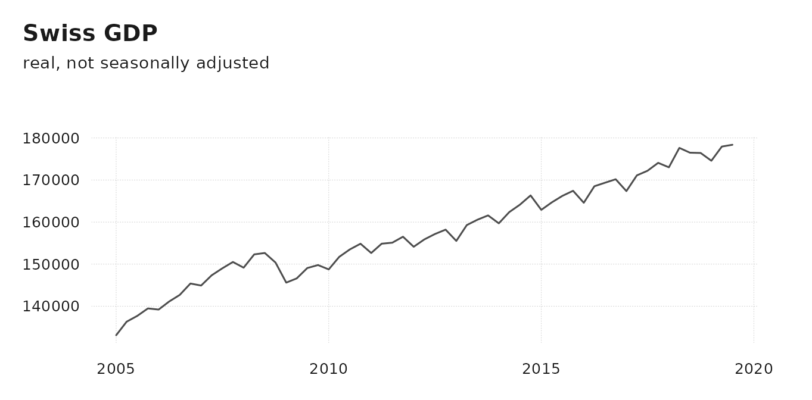
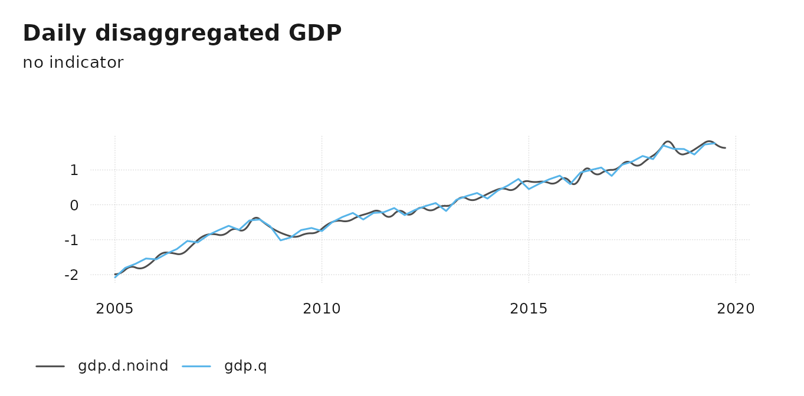
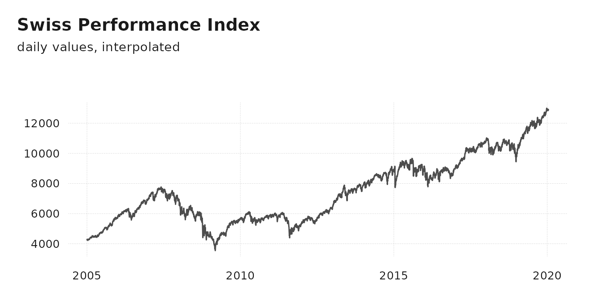
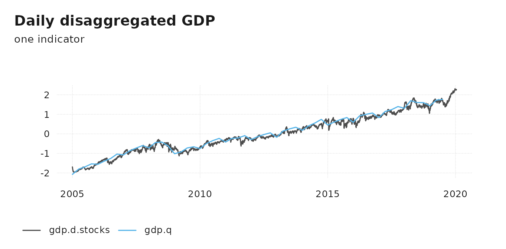

# Temporal Disaggregation to High-Frequency

## Convert between any frequency

Since version 1.0, tempdisagg can convert between most frequencies,
e.g., it can disaggregate a monthly series to daily. It is no longer
restricted to regular conversions, where each low frequency period had
the same number of high frequency periods. Instead, a low frequency
period (e.g. month) can contain any number of high-frequency periods
(e.g. 31, 28 or 29 days). Thanks to Roger Kissling and Stella Sim who
have suggested this idea.

We can not only convert months to days, but also years to days, weeks to
seconds, or academic years to seconds, or lunar years to hours, … The
downside is that the computation time depends on the number of
observations. Thus, for longer high-frequency series, the computation
may take a while.

## Quarterly to daily disaggregation

In the following, we try to disaggregate quarterly GDP of Switzerland to
a hypothetical daily GDP series. The example series are shipped with the
package.

``` r

library(tempdisagg)
data(tempdisagg)
head(gdp.q)
#>         time    value
#> 1 2005-01-01 133101.3
#> 2 2005-04-01 136320.4
#> 3 2005-07-01 137693.7
#> 4 2005-10-01 139475.9
#> 5 2006-01-01 139204.7
#> 6 2006-04-01 141112.5
```

Because we are dealing with daily data, we keep the data in a
`data.frame`, rather than in a `ts` object. Other time series objects,
such as `xts` and `tsibble`, are possible as well. For conversion and
visualization, we use the [tsbox](https://docs.ropensci.org/tsbox/)
package.

``` r

library(tsbox)
ts_plot(gdp.q, title = "Swiss GDP", subtitle = "real, not seasonally adjusted")
```



## No indicator

For models without an indicator series, `method = "fast"` uses the
Chow-Lin method with a *rho* parameter value very close to 1. This is
numerically close to the theoretically preferable Denton-Cholette method
but much faster. Faster, as stated above, has a relative meaning; the
following calculation still takes a few seconds:

``` r

m.d.noind <- td(gdp.q ~ 1, to = "daily", method = "fast")
summary(m.d.noind)
#> 
#> Call:
#> td(formula = gdp.q ~ 1, to = "daily", method = "fast")
#> 
#> Residuals:
#>      Min       1Q   Median       3Q      Max 
#> -20275.5  -6704.0    371.7  10125.2  22872.8 
#> 
#> Coefficients:
#>             Estimate Std. Error t value Pr(>|t|)   
#> (Intercept)   1704.2      517.6   3.292   0.0017 **
#> ---
#> Signif. codes:  0 '***' 0.001 '**' 0.01 '*' 0.05 '.' 0.1 ' ' 1
#> 
#> 'chow-lin-fixed' disaggregation with 'sum' conversion
#> 59 low-freq. obs. converted to 5386 high-freq. obs.
#> Adjusted R-squared: 0.09057  AR1-Parameter:     1
```

Because daily GDP is much lower than monthly GDP, we scale both series
to the same mean and standard deviation:

``` r

gdp.d.noind <- predict(m.d.noind)
ts_plot(
  ts_scale(
    ts_c(gdp.d.noind, gdp.q)
  ),
  title = "Daily disaggregated GDP",
  subtitle = "no indicator"
)
```



Like with all disaggregation methods in tempdisagg, the resulting series
fulfills the aggregation constraint:

``` r

all.equal(ts_frequency(gdp.d.noind, "quarter", aggregate = "sum"), gdp.q)
#> [1] TRUE
```

## Stock market data as an indicator

For a more refined disaggregation, one or several indicator series may
be used. In the following, we use Swiss stock market data to
disaggregate GDP. Data of the stock market index, the SMI, is also
included in tempdisagg:

``` r

ts_plot(spi.d, title = "Swiss Performance Index", subtitle = "daily values, interpolated")
```



Weekend and holiday values have been interpolated, because `td` does not
allow the presence of missing values. For how to interpolate the raw
data, see
[`?spi.d`](http://cynkra.github.io/tempdisagg/reference/spi.d.md).

The following uses the Chow-Lin method to disaggregate the series. A
high *rho* parameter takes into account that the two series are unlikely
to be co-integrated.

``` r

m.d.stocks <- td(gdp.q ~ spi.d, method = "chow-lin-fixed", fixed.rho = 0.9)
summary(m.d.stocks)
#> 
#> Call:
#> td(formula = gdp.q ~ spi.d, method = "chow-lin-fixed", fixed.rho = 0.9)
#> 
#> Residuals:
#>    Min     1Q Median     3Q    Max 
#> -10656  -1760   1076   3796   8891 
#> 
#> Coefficients:
#>              Estimate Std. Error t value Pr(>|t|)    
#> (Intercept) 1.320e+03  2.856e+01   46.22   <2e-16 ***
#> spi.d       5.512e-02  3.735e-03   14.76   <2e-16 ***
#> ---
#> Signif. codes:  0 '***' 0.001 '**' 0.01 '*' 0.05 '.' 0.1 ' ' 1
#> 
#> 'chow-lin-fixed' disaggregation with 'sum' conversion
#> 59 low-freq. obs. converted to 5493 high-freq. obs.
#> Adjusted R-squared: 0.7928   AR1-Parameter:   0.9
```

This results in a much more volatile estimation of daily GDP:

``` r

gdp.d.stocks <- predict(m.d.stocks)
ts_plot(
  ts_scale(
    ts_c(gdp.d.stocks, gdp.q)
  ),
  title = "Daily disaggregated GDP",
  subtitle = "one indicator"
)
```


