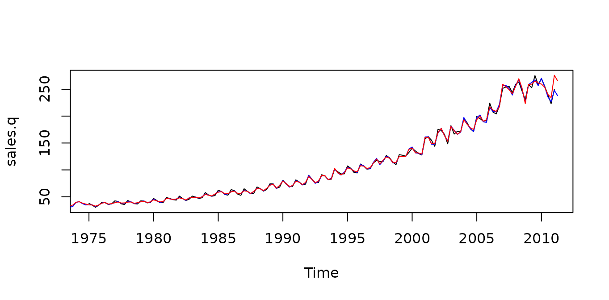

# Temporal Disaggregation of Time Series

This is a short introduction to tempdisagg. Our article on **temporal
disaggregation of time series** () in the R-Journal describes the
package and the theory of temporal disaggregation in more detail.

For citation, please see `citation("tempdisagg")`.

## Disaggregating annual data to quarterly

Suppose we have an annual series and want to create quarterly values
that sum up to the annual values. Let us explore the annual sales of the
pharmaceutical and chemical industry in Switzerland, from which we want
to create a quarterly series.

``` r

library(tempdisagg)
data(swisspharma)
plot(sales.a)
```


## No indicator

The most simple method is `denton-cholette` without an indicator. It
performs a simple interpolation that meets the temporal additivity
constraint. In R, this can be done the following way:

``` r

m1 <- td(sales.a ~ 1, to = "quarterly", method = "denton-cholette")
```

[`td()`](http://cynkra.github.io/tempdisagg/reference/td.md) produces an
object of class `"td"`. The formula, `'sales.a ~ 1'`, indicates that our
low frequency variable will be disaggregated with a constant. The
resulting quarterly values of sales can be extracted with the
[`predict()`](https://rdrr.io/r/stats/predict.html) function:

``` r

predict(m1)
```

As there is no additional information on quarterly movements, the
resulting series is very smooth:

``` r

plot(predict(m1))
```


## Using additional information

While this purely mathematical approach is easy to perform and does not
need any other data series, the economic value of the resulting series
may be limited. There might be a related quarterly series that follows a
similar movement than sales. For example, we may use quarterly exports
of pharmaceutical and chemical products:

``` r

plot(exports.q)
```


``` r

m2 <- td(sales.a ~ 0 + exports.q, method = "denton-cholette")
```

Because we cannot use more than one indicator with the `denton-cholette`
or `denton` method, the intercept must be specified as missing in the
formula (`~ 0`). Contrary to the first example, the `to` argument is
redundant, because the destination frequency can be interfered from the
time series properties of `exports.q`.

The resulting model leads to a much more interesting series:

``` r

plot(predict(m2))
```


As the indicator series is longer than the annual series, there is an
extrapolation period, in which the quarterly sales are forecasted.

With an indicator, the `denton-cholette` method simply transfers the
movement of the indicator to the resulting series. Even if in fact there
were no correlation between the two series, there would be a strong
similarity between the indicator and the resulting series.

## Regression based disaggregation

In contrast, regression based methods transfer the movement only if the
indicator series and the resulting series are actually correlated on the
annual level. For example, a Chow-Lin regression of the same problem as
above can be performed the following way:

``` r

m3 <- td(sales.a ~ exports.q)
```

As `chow-lin-maxlog` is the default method, it does not need to be
specified. Like with the corresponding `lm` method,
[`summary()`](https://rdrr.io/r/base/summary.html) produces an overview
of the regression:

``` r

summary(m3)
#> 
#> Call:
#> td(formula = sales.a ~ exports.q)
#> 
#> Residuals:
#>     Min      1Q  Median      3Q     Max 
#> -77.892  -7.711  -4.628   9.647  36.448 
#> 
#> Coefficients:
#>              Estimate Std. Error t value Pr(>|t|)    
#> (Intercept) 1.241e+01  1.493e+00   8.311 1.06e-09 ***
#> exports.q   1.339e-02  1.672e-04  80.111  < 2e-16 ***
#> ---
#> Signif. codes:  0 '***' 0.001 '**' 0.01 '*' 0.05 '.' 0.1 ' ' 1
#> 
#> 'chow-lin-maxlog' disaggregation with 'sum' conversion
#> 36 low-freq. obs. converted to 158 high-freq. obs.
#> Adjusted R-squared: 0.9946   AR1-Parameter:     0 (truncated)
```

There is indeed a strong correlation between exports and sales, as it
has been assumed in the example above. The coefficient of `exports.q` is
highly significant, and the very high adjusted R-squared points to a
strong relationship between the two variables. The coefficients are the
result of a GLS regression between the annual series.

The estimation of the AR1 parameter, *rho*, was estimated to be
negative; in order to avoid the undesirable side-effects of a negative
*rho*, it has been truncated to 0. This feature can be turned off:

``` r

td(sales.a ~ exports.q, truncated.rho = -1)
#> 
#> Call:
#> td(formula = sales.a ~ exports.q, truncated.rho = -1)
#> 
#> Coefficients:
#> (Intercept)    exports.q  
#>    12.31579      0.01341  
#> 
#> Use summary() for details. 
#> Use predict() to extract the final series.
#>       
#> Use ?td to see the help file.
```

Again, we can extract the resulting quarterly series of sales:

``` r

plot(predict(m3))
```


Like all regression based methods, `chow-lin-maxlog` can also be used
with more than one indicator series (`imports.q` is only significant on
a 10% level in the following example, it probably will not help to
produce a more accurate temporal disaggregation):

``` r

m4 <- td(formula = sales.a ~ exports.q + imports.q)
summary(m4)
#> 
#> Call:
#> td(formula = sales.a ~ exports.q + imports.q)
#> 
#> Residuals:
#>     Min      1Q  Median      3Q     Max 
#> -61.648  -7.139  -2.825   5.508  53.373 
#> 
#> Coefficients:
#>              Estimate Std. Error t value Pr(>|t|)    
#> (Intercept) 11.685855   1.493077   7.827 5.08e-09 ***
#> exports.q    0.011258   0.001158   9.723 3.26e-11 ***
#> imports.q    0.003934   0.002113   1.862   0.0716 .  
#> ---
#> Signif. codes:  0 '***' 0.001 '**' 0.01 '*' 0.05 '.' 0.1 ' ' 1
#> 
#> 'chow-lin-maxlog' disaggregation with 'sum' conversion
#> 36 low-freq. obs. converted to 158 high-freq. obs.
#> Adjusted R-squared: 0.9949   AR1-Parameter:     0 (truncated)
```

## Comparison of methods

In our example, we actually know the true data on quarterly sales, so we
can compare the artificial values to the true values:

``` r

plot(sales.q)
lines(predict(m2), col = "blue") # Denton-Cholette
lines(predict(m3), col = "red") # Chow-Lin
```



With an indicator series, both the Denton method and Chow-Lin produce a
series that is close to the true series. This is, of course, due to fact
that in this example, exports are a good indicator for sales. If the
indicator is less close to the series of interest, the resulting series
will be less close to the true series.
